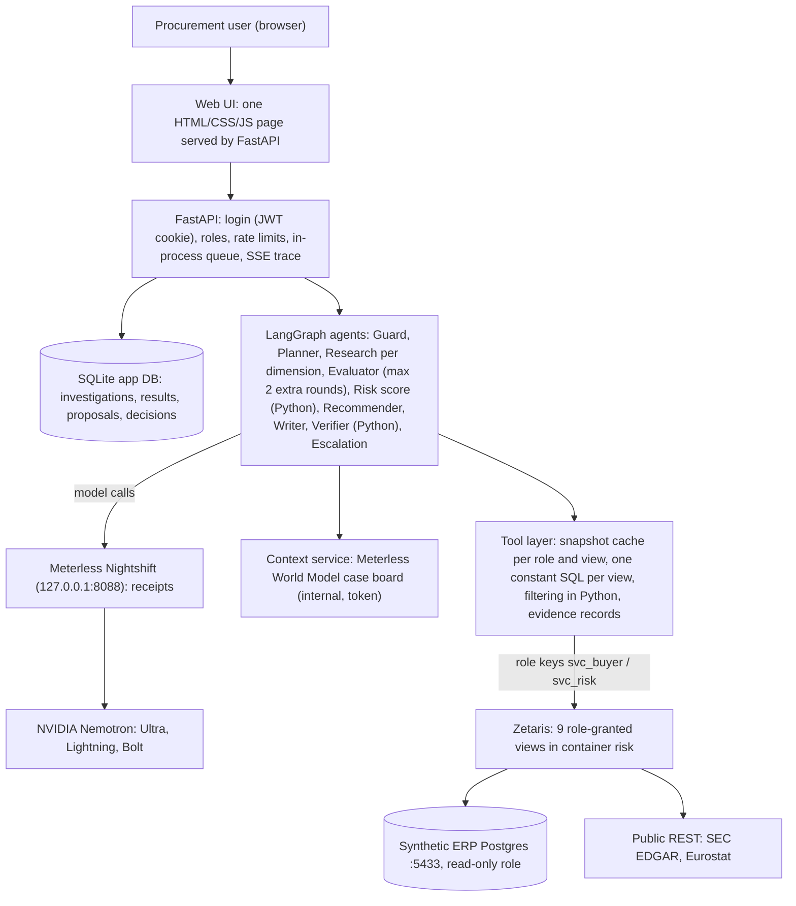

# Supplier Risk Investigator

An explainable multi-agent assistant for procurement teams. Ask *"Why is Microchip (S0003) risky?"* and a
team of agents investigates the supplier. It answers with numbered claims, and every claim cites evidence
from Zetaris SQL. It shows how it got there step by step, and it proposes actions that wait for a human to
approve them.

Open Agent Hackathon 2026, track **"The Agent That Can Explain Why"**.

## What it does
- **Deterministic risk score.** Python computes the score, not the model, from five components:
  delivery, concentration, financial, country and weather.
  - Weather is always "not assessed": the NOAA data was not onboarded. The coverage shows the gap (for
    example 85 %).
  - Every component gives its weight, its reason and its evidence.
- **Claims a verifier checks.**
  - Every claim cites evidence ids.
  - Every number in a claim must match a fact computed from the cited rows. A Python verifier checks this,
    not the model.
  - A claim that fails is rewritten once. If it still fails, it is marked unverified and the case
    escalates.
  - Without evidence, the agent says what is missing instead of guessing.
- **Evidence panel.** For each evidence id: tool, source, Zetaris view, SQL statement id, snapshot time,
  Zetaris query id, row count and the computed facts.
- **"How we got here".** A live timeline of every agent step, streamed over server-sent events: agent,
  exact Nemotron model, Nightshift receipt id, latency, tools and evidence ids.
- **Human in the loop.** The Recommender only proposes actions (safety stock, second source, supplier
  review). Approving records a decision; nothing is executed.
- **Prompt-injection demo.** Supplier S0011 has a planted buyer note: "ignore previous instructions...".
  The note never reaches a model, the trace or the browser. The answer says that one note contained
  instruction-like text and was ignored.

## Architecture

| Layer | What |
| --- | --- |
| Agents | LangGraph: guard -> planner -> research (delivery, concentration, financial, country; weather needs no model and is always "not assessed") -> evaluator (at most 2 extra research rounds) -> score -> recommender -> writer -> verifier -> escalation ([graph](docs/images/agent-graph.png), decision 0007) |
| Data | Zetaris is the only data door. It serves 9 role-granted views in container `risk` over the synthetic ERP, SEC EDGAR and Eurostat. The app reads each view with one constant SQL statement: no parameters and no model input in SQL. It filters by supplier, months and category in Python on a cached snapshot ([decision 0004](docs/decisions/0004-snapshot-reads-and-row-scope.md)). |
| Models | Meterless Nightshift on the local machine, routing to NVIDIA Nemotron: Lightning (research, evaluator), Ultra (planner, recommender, writer), Bolt (guard) |
| Memory | Meterless World Model as the agents' shared case board (`context-service/`, vendored reference implementation) |
| App | FastAPI with one worker and an in-process queue, SQLite, and one plain HTML/CSS/JS page ([decision 0008](docs/decisions/0008-api-queue-sqlite-ui.md)) |

The [planned design](docs/architecture.md) and its [diagram](docs/images/hld.png) show the original
design, before the scope cuts. Decisions: [docs/decisions/](docs/decisions/).

## Scope cuts (honest)
- **H-MEM (long-term memory):** cut for time. The Planner and Recommender run without past cases
  (decision 0007, choice 4).
- **Weather (NOAA):** the source was not onboarded in time. The component is always "not assessed" and
  lowers the coverage.
- **React UI:** cut for time. One plain HTML/CSS/JS page instead ([decision 0008](docs/decisions/0008-api-queue-sqlite-ui.md)).
- **Postgres app database:** SQLite instead. With one process and one worker it is enough (decision
  0008).
- **Zetaris CACHE TABLE:** replaced by the app's in-memory snapshot cache per role and view
  ([decision 0004](docs/decisions/0004-snapshot-reads-and-row-scope.md)).
- **Zetaris column masking:** not configured (SEC-058). Column scope rests on the view grants per role
  alone: buyer views have no price, value or note columns.
- **Multi-worker deployment:** one process with one worker. The queue, live events and model rate
  limiter live in that process (SEC-024, decision 0008).

## How to run
Needs Python 3.12 with [uv](https://docs.astral.sh/uv/), Docker, a local Zetaris install
([docs/zetaris-setup.md](docs/zetaris-setup.md)) and Meterless Nightshift with the Nemotron models.

1. `uv sync`, then copy `.env.example` to `.env` and fill in your own values. Never commit `.env`.
2. Synthetic ERP: `scripts/erp_up.sh up`. Then register it in Zetaris as described in
   docs/zetaris-setup.md.
3. Context service (World Model): set `CONTEXT_SERVICE_TOKEN` (`openssl rand -hex 32`), then run
   `docker compose -f docker-compose.yml -f docker-compose.dev.yml up -d context-service`. It listens on
   127.0.0.1:7070.
4. App settings in `.env`:
   - `APP_DATABASE_URL=sqlite:///data/local/app.db`;
   - `JWT_SECRET` (32+ characters);
   - `DEMO_BUYER_PASSWORD`, `DEMO_RISK_PASSWORD`, `DEMO_DIRECTOR_PASSWORD` (8+ characters each; empty
     disables a user);
   - keep `LANGCHAIN_TRACING_V2=false`.
5. `scripts/run_app.sh`, then open http://127.0.0.1:8000. It runs one uvicorn worker on purpose (decision
   0008). The data cache warms in the background, and a banner shows until it is ready.
6. Optional checks:
   - `uv run python scripts/check_llm.py` (Nightshift);
   - `uv run python scripts/warm_cache.py` (Zetaris views);
   - `uv run python scripts/investigate.py "Why is S0003 risky?"` (command line).

Tests: `uv run pytest -q -m "not integration"` (unit and security). Integration tests need the local
services: `-m integration`.

## Roles
Roles come from the login, never from the question. A body field such as `"role": "director"` is
rejected.

| Demo user | Sees | May do |
| --- | --- | --- |
| `buyer` | Only suppliers of its category (electronics); no prices or contract values | Ask; approve or reject low- and medium-impact proposals of its own investigations |
| `risk_manager` | All categories, contract values, financials | Ask; approve or reject any proposal (inbox) |
| `director` | All categories; every user's investigations (read-only) | Ask; no proposals and no approvals |

Users read only their own investigations; the director may read all. Anyone else gets 404.

## Security
The design assumes a prompt injection may succeed and limits what it can do:
- **Scope.**
  - Column scope comes from Zetaris view grants per role: one read-only key per role, and buyer views
    have no prices, contract values or notes.
  - Row scope is the buyer's category from the session. It is filtered in Python on the snapshot
    (decision 0004).
- **SQL.** One constant SQL statement per view: no parameters and no model or user input in SQL. Tool
  arguments are validated with Pydantic.
- **Untrusted text.** Text from Zetaris, documents and the model is data, never instructions. Free-text
  ERP fields go through an injection detector. Evidence rows never reach the browser.
- **Approvals.** Actions are only proposed, and a decision is recorded once per proposal.
- **Session.** An httpOnly, SameSite=Strict cookie (HS256, 30 minutes); login throttling; a cross-site
  write check.
- **Browser.** A strict Content Security Policy (no inline code, no CDN). The UI renders data with
  `textContent` only, and a test enforces that.
- **Limits.** 15 model calls and 15 minutes per investigation; a 1,000-character question; a 16 KB body;
  a 429 for a full queue and above 10 investigations per user per hour.
- **Secrets.** Secrets live in `.env` (git-ignored) as SecretStr settings. They are redacted from logs.
  LangSmith tracing is refused at startup.
- **Red team.** The security-breaker subagent attacks every feature. Findings, with reproducing tests,
  are in [docs/security-review.md](docs/security-review.md).

Privacy: [docs/privacy.md](docs/privacy.md). Production secrets: [docs/production-secrets.md](docs/production-secrets.md).

## How this was built
Built with Claude Code (decision 0002). Each feature followed the same workflow, set down in
[AGENTS.md](AGENTS.md) and [CLAUDE.md](CLAUDE.md) and enforced by rules, a hook and a skill:

1. A branch per feature (`feat/...`, `fix/...`). Never work on `main`.
2. Tests first: run them and see them fail, then write the smallest code that passes.
3. ruff, mypy strict, unit tests, and integration tests for the touched area.
4. The **security-breaker** subagent attacks the feature. Critical and High findings are fixed now, test
   first; every finding goes into docs/security-review.md with a strict-xfail test until it is fixed.
5. Test logs (docs/test-runs/, docs/test-log.md), a devlog entry, and a decision record when the design
   changes.
6. Commit, push and open a PR. Merge only when GitHub Actions is green, with a merge commit (`/finish-feature`).

Project rules live in `.claude/rules/` (Python style, logging, security, tests). A Stop hook runs lint and
unit tests after every turn.

Example: the prompt for Feature 7b (this API and UI), as given to Claude Code:

> Feature 7b: feat/api-ui (API, queue, login, live trace and a simple UI in one feature; we are short on
> time, so keep it simple, but TDD and the security review still apply). Branch from updated main. Read
> architecture §5, §8.3, §9, §10, §13, ADR 0007, SEC-084 and SEC-024. Plan briefly, then build.
>
> 1. FastAPI under /api/v1:
>    - POST /auth/login for 3 seeded demo users (buyer with one category from suppliers.yaml,
>      risk_manager, director). Passwords from .env (DEMO_BUYER_PASSWORD, DEMO_RISK_PASSWORD,
>      DEMO_DIRECTOR_PASSWORD, placeholders in .env.example), hashed at startup. JWT signed with
>      JWT_SECRET from .env, 30 min expiry, in an httpOnly, SameSite=Strict cookie.
>    - POST /investigations {question} -> 202 {id, queue_position}; GET /investigations (own only;
>      director may see all); GET /investigations/{id}; GET /investigations/{id}/events (SSE, live trace
>      events); DELETE /investigations/{id} (own data, GDPR erasure: also removes stored results).
>    - POST /proposals/{id}/approve and /reject (buyer and risk_manager): only records the decision,
>      never executes anything.
> 2. Queue: an in-process asyncio queue with 1 worker, 1 API process (SEC-024), max queue length -> 429,
>    10 investigations per user per hour -> 429 with a friendly message.
> 3. Storage: SQLite via SQLAlchemy (APP_DATABASE_URL), tables investigations, results, proposals and
>    decisions. Retention setting (default 30 days) with a purge on startup. Record the deviation from
>    Postgres in ADR 0008.
> 4. SEC-084 API side: users read only their own investigations and only scoped case-board views.
> 5. UI: one page served by FastAPI from backend/app/web/static (plain HTML, CSS and JS, no build step,
>    no CDN). Login; question box with 3 example buttons (S0003 "Why is Microchip risky?", S0005 Celanese,
>    the S0011 injection demo); a live agent timeline from SSE (agent, model, Nightshift receipt id,
>    latency, tools, evidence ids); the result: rating badge with coverage and critical signals, score
>    components with reasons, claims with clickable evidence ids opening an evidence panel (tool, view,
>    snapshot_at, Zetaris query id, facts), the missing/notes section including the injection notice, and
>    pending proposals with approve/reject. A banner while the cache is warming (from /ready). Strict CSP;
>    data is only ever rendered with textContent, never innerHTML.
> 6. Startup warms the cache in the background. scripts/run_app.sh starts uvicorn with 1 worker on
>    127.0.0.1:8000. Assert at startup that LangSmith/LangChain tracing is off (LANGCHAIN_TRACING_V2 not
>    true) and log it.
> 7. Tests: API tests with a fake investigator (login, roles, own-investigation isolation, 429s, SSE,
>    proposals never execute, delete removes data); a test that the static JS never uses innerHTML for
>    data; one slow_live end-to-end test through the API for S0003.
>
> Then security-breaker, test logs, /finish-feature. Ask me before committing; if CI is green you may
> merge. Out of scope: Postgres, H-MEM, multi-worker, React.

What came out of it: [decision 0008](docs/decisions/0008-api-queue-sqlite-ui.md), SEC-100..110 in the
security review, and the [test run](docs/test-runs/2026-10-27-feat-api-ui.md).

## Sponsor technology
- **Zetaris**: the single data layer. It registers the synthetic ERP (Postgres), SEC EDGAR and Eurostat
  (REST) and serves 9 risk views, granted per role user (svc_buyer, svc_risk). The app reads each view
  with one constant SQL statement (`backend/app/tools/views.py`).
- **Meterless Nightshift**: the AI provider, an OpenAI-compatible runtime on the local machine. The app
  pins exact model ids (never `meterless/auto` or `meterless/fusion`) and stores the receipt id of every
  call. It also respects the free-tier limit: a shared limiter at 30 requests/minute, at most 2
  concurrent calls, and a budget of 15 calls per investigation.
- **Meterless engines**: the World Model reference implementation, vendored unchanged and served by
  `context-service/` (conformance suite in CI), is the agents' shared case board. H-MEM was cut from the
  scope.
- **NVIDIA**: Nemotron 3.5 Lightning, Nemotron 3 Ultra and Nemotron 3.5 Bolt through Nightshift.
- **Coding tool**: Claude Code.

Feedback for the sponsors is in [docs/devlog.md](docs/devlog.md#sponsor-feedback). Code used unchanged
from others is listed in [PRE_EXISTING.md](PRE_EXISTING.md).
