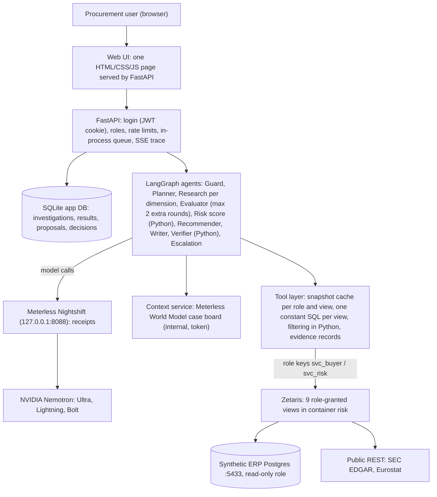

# Supplier Risk Investigator
### An Explainable Multi-Agent AI System for Enterprise Supplier Risk Intelligence

[](https://www.python.org/)
[](https://www.langchain.com/langgraph)
[](https://fastapi.tiangolo.com/)
[](https://build.nvidia.com/)
[](https://www.zetaris.com/)
[](https://www.docker.com/)

**Supplier Risk Investigator** is an explainable, multi-agent AI application designed to help enterprise procurement teams investigate supplier risks through collaborative AI agents, enterprise data integration, evidence-grounded reasoning and human-in-the-loop decision-making.

Instead of relying on an LLM to generate unsupported risk assessments, the system combines specialized AI agents with deterministic Python-based calculations and independent evidence verification.

The goal is to make supplier risk investigations more transparent, traceable, and actionable.

> Developed as part of **Open Agent Hackathon 2026**, organized by GenAI.Works, under the track **"The Agent That Can Explain Why."**

---

## 🎬 Project Demo

**Watch the complete application walkthrough:**

[](https://youtu.be/zaI_SsUVR88)

▶️ [Watch Supplier Risk Investigator on YouTube](https://youtu.be/zaI_SsUVR88)

The demonstration covers:

- Application authentication and role-based access.
- Natural-language supplier risk investigation.
- Multi-agent orchestration and execution tracing.
- Enterprise data integration through Zetaris Data Harness.
- Evidence inspection and SQL-derived facts.
- Supplier risk assessment and mitigation recommendations.

---

## 🎯 Business Problem

Supplier disruptions can significantly affect procurement operations, financial performance, and business continuity.

Traditional supplier risk assessment processes often require analysts to investigate information across multiple data sources, manually evaluate risk indicators, and justify their conclusions.

The challenge is not simply identifying a potentially risky supplier. Decision-makers also need to understand:

- Why is this supplier considered risky?
- Which evidence supports each risk indicator?
- How was the risk score calculated?
- How reliable and complete is the available information?
- What actions should procurement teams consider?
- Can decision-makers independently verify AI-generated conclusions?

Supplier Risk Investigator addresses these challenges through an evidence-driven, multi-agent investigation workflow.

---

## 💡 Solution Overview

The application allows procurement professionals to investigate suppliers using natural-language questions.

Example:

`Why is Microchip (S0003) risky?`

A coordinated team of AI agents investigates relevant supplier risk dimensions, retrieves supporting evidence, evaluates the findings, calculates a deterministic risk score, and generates an explainable assessment.

### Core Capabilities

#### 1. Multi-Agent Investigation Architecture
- Specialized agents for request guarding, planning, research, evaluation, recommendations, and report generation.
- LangGraph-based agent orchestration.
- Controlled investigation rounds.
- Live agent execution timeline.

#### 2. Evidence-Grounded AI
- Claims reference supporting evidence identifiers.
- Evidence is retrieved through Zetaris Data Harness.
- SQL-derived facts are independently verified using Python.
- Unsupported numerical claims are rejected or escalated.
- Missing information is explicitly identified instead of being fabricated.

#### 3. Deterministic Risk Scoring

Python calculates the supplier risk score using five components:

- Delivery risk
- Supplier concentration risk
- Financial risk
- Country risk
- Weather risk

The LLM does not determine the numerical risk score.

Weather risk is currently marked as **Not Assessed** because the NOAA data integration was outside the hackathon implementation scope.

#### 4. Enterprise Data Integration
- Zetaris Data Harness provides the unified data access layer.
- Synthetic ERP data through PostgreSQL.
- Public financial information through SEC EDGAR.
- Macroeconomic information through Eurostat.
- Role-based data access through predefined views.

#### 5. Human-in-the-Loop Decision Making
- AI agents propose supplier risk mitigation actions.
- Procurement users can approve or reject proposals.
- Decisions are recorded for accountability.
- No external procurement action is executed automatically.

#### 6. Security and Governance
- Role-Based Access Control (RBAC).
- JWT-based authentication.
- Read-only data access.
- SQL query restrictions.
- Prompt-injection handling.
- Input validation and request limits.
- Content Security Policy.
- Safe frontend rendering.

---

## 🏗️ System Architecture

The system follows a modular architecture separating the user interface, API layer, agent orchestration, enterprise data integration, model inference, and application persistence.

### High-Level Architecture



### Agent Workflow

| Agent / Component | Responsibility |
|---|---|
| Guard | Validates and classifies incoming investigation requests |
| Planner | Creates the investigation plan |
| Research Agents | Investigate delivery, concentration, financial, and country risks |
| Evaluator | Identifies evidence gaps and requests additional research |
| Risk Scoring Engine | Calculates deterministic risk scores using Python |
| Recommender | Proposes risk mitigation actions |
| Writer | Produces the final evidence-grounded assessment |
| Verifier | Independently checks claims against computed evidence |
| Escalation | Handles unresolved verification failures |


| Layer | What |
| --- | --- |
| Agents | LangGraph: guard -> planner -> research (delivery, concentration, financial, country; weather needs no model and is always "not assessed") -> evaluator (at most 2 extra research rounds) -> score -> recommender -> writer -> verifier -> escalation ([graph](docs/images/agent-graph.png), decision 0007) |
| Data | Zetaris is the only data door. It serves 9 role-granted views in container `risk` over the synthetic ERP, SEC EDGAR and Eurostat. The app reads each view with one constant SQL statement: no parameters and no model input in SQL. It filters by supplier, months and category in Python on a cached snapshot ([decision 0004](docs/decisions/0004-snapshot-reads-and-row-scope.md)). |
| Models | Meterless Nightshift on the local machine, routing to NVIDIA Nemotron: Lightning (research, evaluator), Ultra (planner, recommender, writer), Bolt (guard) |
| Memory | Meterless World Model as the agents' shared case board (`context-service/`, vendored reference implementation) |
| App | FastAPI with one worker and an in-process queue, SQLite, and one plain HTML/CSS/JS page ([decision 0008](docs/decisions/0008-api-queue-sqlite-ui.md)) |

---

## 🤖 Multi-Agent Workflow

The investigation workflow is coordinated using LangGraph.

1. **Request Guarding:** Validates incoming requests and handles potentially malicious instructions.
2. **Investigation Planning:** The Planner identifies the relevant risk dimensions and creates an investigation plan.
3. **Evidence Collection:** Specialized research agents retrieve supplier information through Zetaris.
4. **Evidence Evaluation:** The Evaluator reviews the collected information and identifies missing evidence.
5. **Risk Calculation:** Python-based scoring calculates the numerical risk score.
6. **Recommendations:** The Recommender proposes mitigation actions based on the available findings.
7. **Report Generation:** The Writer produces an explainable investigation report.
8. **Evidence Verification:** A Python verifier checks numerical claims against the computed evidence.
9. **Final Assessment:** Verified findings are presented with supporting evidence and recommendations.

The workflow supports controlled additional research rounds and escalation when verification remains unsuccessful.

---

## 🛠️ Technology Stack

The project combines agent orchestration frameworks, LLM inference services, enterprise data integration, backend development, security, testing, and DevOps tooling.

### Programming Languages
- Python 3.12+
- JavaScript
- HTML5
- CSS3

### Agentic AI and LLM Frameworks
- **LangGraph:** Multi-agent orchestration and workflow management.
- **NVIDIA Nemotron 3 Ultra:** Planning, recommendations, and report generation.
- **NVIDIA Nemotron 3.5 Lightning:** Research and evaluation.
- **NVIDIA Nemotron 3.5 Bolt:** Request guarding.
- **OpenAI Python SDK:** Integration with OpenAI-compatible model inference APIs.
- **Meterless Nightshift:** LLM inference runtime.
- **Meterless World Model:** Shared investigation context and case-board service.

### Enterprise Data Integration
- **Zetaris Data Harness:** Unified enterprise data access layer.
- **PostgreSQL:** Synthetic ERP data source.
- **SEC EDGAR:** Public financial information.
- **Eurostat:** Public economic and statistical datasets.
- **REST APIs and SQL:** Data retrieval and integration.

### Backend Development
- **FastAPI:** Backend API development.
- **Uvicorn:** ASGI application server.
- **SQLAlchemy:** Database ORM.
- **SQLite:** Application persistence.
- **Psycopg 3:** PostgreSQL connectivity.
- **HTTPX:** HTTP client for external and internal service communication.
- **Server-Sent Events (SSE):** Real-time agent execution updates.

### Frontend Development
- HTML5
- CSS3
- JavaScript
- Server-Sent Events (SSE)

### Data Processing and Validation
- NumPy
- Pydantic
- Pydantic Settings
- PyYAML
- Faker

### Security and Authentication
- PyJWT
- JWT-based authentication
- Role-Based Access Control (RBAC)
- HTTP-only cookies
- Pydantic input validation
- Read-only SQL access
- Prompt-injection detection
- Content Security Policy (CSP)

### DevOps and Infrastructure
- Docker
- Docker Compose
- GitHub Actions
- uv – Python dependency and environment management
- python-dotenv – Environment configuration

### Testing and Code Quality
- pytest
- pytest-asyncio
- pytest-cov
- Respx
- Locust – Load testing
- Ruff – Linting and formatting
- mypy – Static type checking
- pre-commit – Automated code quality checks

### AI-Assisted Development
- Claude Code – AI-assisted software engineering and development workflow.

The exact dependency declarations and development dependency groups are maintained in `pyproject.toml` and `uv.lock`.

---

## 🔌 Data Sources and Integration

The application combines synthetic enterprise data and publicly available datasets.

| Data Source | Purpose |
|---|---|
| Synthetic ERP (PostgreSQL) | Supplier profiles, procurement, contracts, and delivery information |
| SEC EDGAR | Public financial information and company filings |
| Eurostat | Economic and country-level indicators |
| NOAA | Planned weather-risk integration; not currently onboarded |

**Zetaris Data Harness** acts as the unified data access layer, exposing predefined, role-granted views to the application.

This approach separates the AI application from individual source systems and provides a controlled interface for retrieving enterprise information.

---

The [planned design](docs/architecture.md) and its [diagram](docs/images/hld.png) show the original
design, before the scope cuts. Decisions: [docs/decisions/](docs/decisions/).

## Scope cuts
- **H-MEM (long-term memory):** cut for time. The Planner and Recommender run without past cases
  (decision 0007, choice 4).
- **Weather (NOAA):** the source was not onboarded in time. The component is always "not assessed" and
  lowers the coverage.
- **React UI:** cut for time. One plain HTML/CSS/JS page instead ([decision 0008](docs/decisions/0008-api-queue-sqlite-ui.md)).
- **Postgres app database:** SQLite instead. With one process and one worker it is enough (decision
  0008).
- **Zetaris CACHE TABLE:** replaced by the app's in-memory snapshot cache per role and view
  ([decision 0004](docs/decisions/0004-snapshot-reads-and-row-scope.md)).
- **Zetaris column masking:** not configured (SEC-058). Column scope rests on the view grants per role
  alone: buyer views have no price, value or note columns.
- **Multi-worker deployment:** one process with one worker. The queue, live events and model rate
  limiter live in that process (SEC-024, decision 0008).

---

## 📂 Repository Structure

```text
supplier-risk/
│
├── .claude/             # Claude Code project configuration
├── .github/             # GitHub Actions workflows
├── backend/             # FastAPI application and agent implementation
├── context-service/     # Meterless World Model context service
├── data_pipeline/       # Data preparation and Zetaris SQL generation
├── docs/                # Architecture, design decisions and security documentation
├── evals/               # Evaluation assets
├── frontend/            # HTML, CSS and JavaScript interface
├── infra/               # Infrastructure configuration
├── loadtests/           # Load testing
├── scripts/             # Application and development scripts
│
├── .env.example
├── .gitignore
├── docker-compose.yml
├── docker-compose.dev.yml
├── pyproject.toml
├── uv.lock
├── .python-version
├── AGENTS.md
├── CLAUDE.md
└── README.md
```

---

## 🚀 Getting Started

### Prerequisites

- Python 3.12+
- uv
- Docker and Docker Compose
- Local Zetaris installation
- Meterless Nightshift runtime
- Access to the required NVIDIA Nemotron models

Needs Python 3.12 with [uv](https://docs.astral.sh/uv/), Docker, a local Zetaris install
([docs/zetaris-setup.md](docs/zetaris-setup.md)) and Meterless Nightshift with the Nemotron models.

### 1. Clone the Repository

```bash
git clone https://github.com/abhinandansamal/supplier-risk.git
cd supplier-risk
```

### 2. Install Dependencies

```bash
uv sync
```

### 3. Configure Environment Variables

```bash
cp .env.example .env
```

Configure the required application secrets, database settings, demo account credentials, Zetaris connections, and context-service token.

Generate a context-service token:

```bash
openssl rand -hex 32
```

Never commit `.env` or publish real credentials.

Keep LangChain tracing disabled for this application configuration:

```text
LANGCHAIN_TRACING_V2=false
```

Refer to `.env.example` and the project documentation for the complete configuration requirements.

### 4. Start the Synthetic ERP Environment

```bash
scripts/erp_up.sh up
```

Register and configure the ERP source in Zetaris according to:

`docs/zetaris-setup.md`

### 5. Start the Context Service

```bash
docker compose -f docker-compose.yml -f docker-compose.dev.yml up -d context-service
```

The development context service listens on:

```text
127.0.0.1:7070
```

### 6. Configure Zetaris and the Model Runtime

Complete the Zetaris setup guide and ensure the expected role-granted views are available.

Start Meterless Nightshift and verify that the configured Nemotron model IDs are accessible.

Optional connectivity checks:

```bash
uv run python scripts/check_llm.py
uv run python scripts/warm_cache.py
```

### 7. Run the Application

```bash
scripts/run_app.sh
```

Open the application:

```text
http://127.0.0.1:8000
```

The application intentionally runs with one Uvicorn worker because the investigation queue, live events, and model rate limiter are process-local in this implementation.

### 8. Run a Command-Line Investigation (Optional)

```bash
uv run python scripts/investigate.py "Why is S0003 risky?"
```

---

## 🧪 Testing and Quality Assurance

The project incorporates automated testing and code-quality checks.

### Run Unit and Security Tests

```bash
uv run pytest -q -m "not integration"
```

### Run Integration Tests

Integration tests require the relevant local services.

```bash
uv run pytest -q -m integration
```

### Run Static Type Checking

```bash
uv run mypy
```

### Run Linting

```bash
uv run ruff check .
```

### Load Testing

Load-testing configurations are maintained under:

```text
loadtests/
```

Locust is used for load-testing scenarios.

---

---

## 👥 Roles and Permissions
The user's role is derived from the authenticated session, not from the investigation question or request body.

| Role | Data Visibility | Permissions |
| --- | --- | --- |
| `buyer` | Suppliers in assigned category; restricted financial and sensitive columns | Investigate and approve/reject eligible proposals from own investigations |
| `risk_manager` | All categories, contract values, and financial information | Investigate and approve/reject proposals |
| `director` | All categories and investigations across users | Read investigations; cannot approve or reject proposals |

Users can read their own investigations. The Director role can read all investigations.

Demo passwords are configured through environment variables. Never publish real credentials in the repository.

---

## 🔐 Security Architecture
The design assumes a prompt injection may succeed and limits what it can do:
- **Scope.**
  - Column scope comes from Zetaris view grants per role: one read-only key per role, and buyer views
    have no prices, contract values or notes.
  - Row scope is the buyer's category from the session. It is filtered in Python on the snapshot
    (decision 0004).
- **SQL.** One constant SQL statement per view: no parameters and no model or user input in SQL. Tool
  arguments are validated with Pydantic.
- **Untrusted text.** Text from Zetaris, documents and the model is data, never instructions. Free-text
  ERP fields go through an injection detector. Evidence rows never reach the browser.
- **Approvals.** Actions are only proposed, and a decision is recorded once per proposal.
- **Session.** An httpOnly, SameSite=Strict cookie (HS256, 30 minutes); login throttling; a cross-site
  write check.
- **Browser.** A strict Content Security Policy (no inline code, no CDN). The UI renders data with
  `textContent` only, and a test enforces that.
- **Limits.** 15 model calls and 15 minutes per investigation; a 1,000-character question; a 16 KB body;
  a 429 for a full queue and above 10 investigations per user per hour.
- **Secrets.** Secrets live in `.env` (git-ignored) as SecretStr settings. They are redacted from logs.
  LangSmith tracing is refused at startup.
- **Red team.** The security-breaker subagent attacks every feature. Findings, with reproducing tests,
  are in [docs/security-review.md](docs/security-review.md).

Privacy: [docs/privacy.md](docs/privacy.md). Production secrets: [docs/production-secrets.md](docs/production-secrets.md).

---

## Known issues
- **Each demo account should be used by one person at a time.** Six or more logins of the same account at
  the same moment can lock it for 15 minutes (SEC-111, found by the [load test](docs/load-test-report.md)).
- Other open security findings, each with a strict-xfail test, are listed in
  [docs/security-review.md](docs/security-review.md).

---

## How this was built
Built with Claude Code (decision 0002). Each feature followed the same workflow, set down in
[AGENTS.md](AGENTS.md) and [CLAUDE.md](CLAUDE.md) and enforced by rules, a hook and a skill:

1. A branch per feature (`feat/...`, `fix/...`). Never work on `main`.
2. Tests first: run them and see them fail, then write the smallest code that passes.
3. ruff, mypy strict, unit tests, and integration tests for the touched area.
4. The **security-breaker** subagent attacks the feature. Critical and High findings are fixed now, test
   first; every finding goes into docs/security-review.md with a strict-xfail test until it is fixed.
5. Test logs (docs/test-runs/, docs/test-log.md), a devlog entry, and a decision record when the design
   changes.
6. Commit, push and open a PR. Merge only when GitHub Actions is green, with a merge commit (`/finish-feature`).

Project rules live in `.claude/rules/` (Python style, logging, security, tests). A Stop hook runs lint and
unit tests after every turn.

Example: the prompt for Feature 7b (this API and UI), as given to Claude Code:

> Feature 7b: feat/api-ui (API, queue, login, live trace and a simple UI in one feature; we are short on
> time, so keep it simple, but TDD and the security review still apply). Branch from updated main. Read
> architecture §5, §8.3, §9, §10, §13, ADR 0007, SEC-084 and SEC-024. Plan briefly, then build.
>
> 1. FastAPI under /api/v1:
>    - POST /auth/login for 3 seeded demo users (buyer with one category from suppliers.yaml,
>      risk_manager, director). Passwords from .env (DEMO_BUYER_PASSWORD, DEMO_RISK_PASSWORD,
>      DEMO_DIRECTOR_PASSWORD, placeholders in .env.example), hashed at startup. JWT signed with
>      JWT_SECRET from .env, 30 min expiry, in an httpOnly, SameSite=Strict cookie.
>    - POST /investigations {question} -> 202 {id, queue_position}; GET /investigations (own only;
>      director may see all); GET /investigations/{id}; GET /investigations/{id}/events (SSE, live trace
>      events); DELETE /investigations/{id} (own data, GDPR erasure: also removes stored results).
>    - POST /proposals/{id}/approve and /reject (buyer and risk_manager): only records the decision,
>      never executes anything.
> 2. Queue: an in-process asyncio queue with 1 worker, 1 API process (SEC-024), max queue length -> 429,
>    10 investigations per user per hour -> 429 with a friendly message.
> 3. Storage: SQLite via SQLAlchemy (APP_DATABASE_URL), tables investigations, results, proposals and
>    decisions. Retention setting (default 30 days) with a purge on startup. Record the deviation from
>    Postgres in ADR 0008.
> 4. SEC-084 API side: users read only their own investigations and only scoped case-board views.
> 5. UI: one page served by FastAPI from backend/app/web/static (plain HTML, CSS and JS, no build step,
>    no CDN). Login; question box with 3 example buttons (S0003 "Why is Microchip risky?", S0005 Celanese,
>    the S0011 injection demo); a live agent timeline from SSE (agent, model, Nightshift receipt id,
>    latency, tools, evidence ids); the result: rating badge with coverage and critical signals, score
>    components with reasons, claims with clickable evidence ids opening an evidence panel (tool, view,
>    snapshot_at, Zetaris query id, facts), the missing/notes section including the injection notice, and
>    pending proposals with approve/reject. A banner while the cache is warming (from /ready). Strict CSP;
>    data is only ever rendered with textContent, never innerHTML.
> 6. Startup warms the cache in the background. scripts/run_app.sh starts uvicorn with 1 worker on
>    127.0.0.1:8000. Assert at startup that LangSmith/LangChain tracing is off (LANGCHAIN_TRACING_V2 not
>    true) and log it.
> 7. Tests: API tests with a fake investigator (login, roles, own-investigation isolation, 429s, SSE,
>    proposals never execute, delete removes data); a test that the static JS never uses innerHTML for
>    data; one slow_live end-to-end test through the API for S0003.
>
> Then security-breaker, test logs, /finish-feature. Ask me before committing; if CI is green you may
> merge. Out of scope: Postgres, H-MEM, multi-worker, React.

What came out of it: [decision 0008](docs/decisions/0008-api-queue-sqlite-ui.md), SEC-100..110 in the
security review, and the [test run](docs/test-runs/2026-10-27-feat-api-ui.md).

---

## Sponsor technology
- **Zetaris**: the single data layer. It registers the synthetic ERP (Postgres), SEC EDGAR and Eurostat
  (REST) and serves 9 risk views, granted per role user (svc_buyer, svc_risk). The app reads each view
  with one constant SQL statement (`backend/app/tools/views.py`).
- **Meterless Nightshift**: the AI provider, an OpenAI-compatible runtime on the local machine. The app
  pins exact model ids (never `meterless/auto` or `meterless/fusion`) and stores the receipt id of every
  call. It also respects the free-tier limit: a shared limiter at 30 requests/minute, at most 2
  concurrent calls, and a budget of 15 calls per investigation.
- **Meterless engines**: the World Model reference implementation, vendored unchanged and served by
  `context-service/` (conformance suite in CI), is the agents' shared case board. H-MEM was cut from the
  scope.
- **NVIDIA**: Nemotron 3.5 Lightning, Nemotron 3 Ultra and Nemotron 3.5 Bolt through Nightshift.

Feedback for the sponsors is in [docs/devlog.md](docs/devlog.md#sponsor-feedback). Code used unchanged
from others is listed in [PRE_EXISTING.md](PRE_EXISTING.md).

---

## ⚠️ Current Limitations and Future Improvements

The project was developed within a hackathon timeframe. Some architectural decisions and planned integrations were intentionally simplified.

### Current Limitations

| Area | Current Implementation / Limitation |
|---|---|
| Weather Risk | NOAA integration is not implemented; weather remains Not Assessed. |
| Long-Term Memory | Historical case memory was outside the final hackathon scope. |
| Frontend | Lightweight HTML/CSS/JavaScript rather than React. |
| Application Database | SQLite is used for application persistence. |
| Deployment | Single application process and one worker. |
| Background Processing | Investigation queue is process-local. |
| Data Caching | In-process snapshot cache rather than Zetaris CACHE TABLE. |
| Column Masking | Zetaris column masking was not configured; access restrictions rely on role-granted views. |
| Procurement Actions | Approvals record decisions but do not execute external procurement actions. |

### Planned Improvements

- Integrate and validate a weather-risk data source.
- Implement historical investigation memory and case retrieval.
- Expand evaluation datasets and agent performance benchmarks.
- Improve the frontend and investigation visualizations.
- Introduce scalable background job processing.
- Evaluate production-grade persistence and deployment options.
- Expand observability and automated security testing.
- Improve operational monitoring.

These are future improvements, not claims about features already delivered.

---

## 🏆 Hackathon Participation and Credentials

Developed as part of **Open Agent Hackathon 2026**, organized by GenAI.Works.

**Hackathon Track:** The Agent That Can Explain Why

### Credentials

**Open Agent Hackathon 2026 – Certificate of Participation**

Issued by GenAI.Works.

[Verify Certificate](https://hackathon.genai.works/verify/CERT-2026-ZFNQM)

**Zetaris × SpaceXSI AI Data Harness Solution Developer**

Verified credential issued by Zetaris.

[Verify Zetaris Credential](https://www.zetaris.com/credentials/ztr-dhsd-3wy9b9)

---

## 👨‍💻 Author

**Abhinandan Samal**

M.Sc. Data Science | Data Engineering | AI Engineering

GitHub: [@abhinandansamal](https://github.com/abhinandansamal)

Areas of interest:

- Agentic AI
- Multi-Agent Systems
- Generative AI
- Large Language Models
- Retrieval-Augmented Generation (RAG)
- Enterprise AI Applications
- Data Engineering

---

## 🤝 Feedback and Contributions

Suggestions, issues, and technical feedback are welcome.

Please open an issue to discuss bugs, improvements, or potential contributions.

---

*This is an evolving AI engineering project. Development and improvements will continue beyond the hackathon implementation.*
